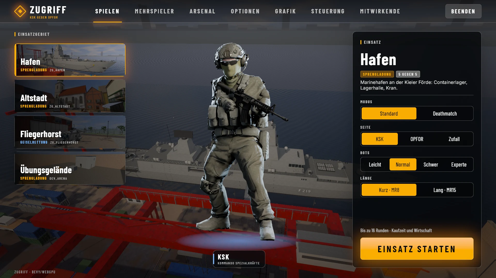
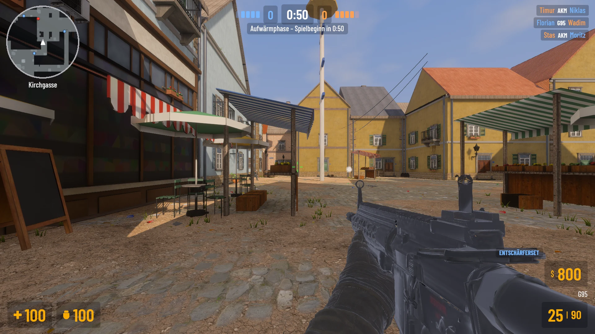
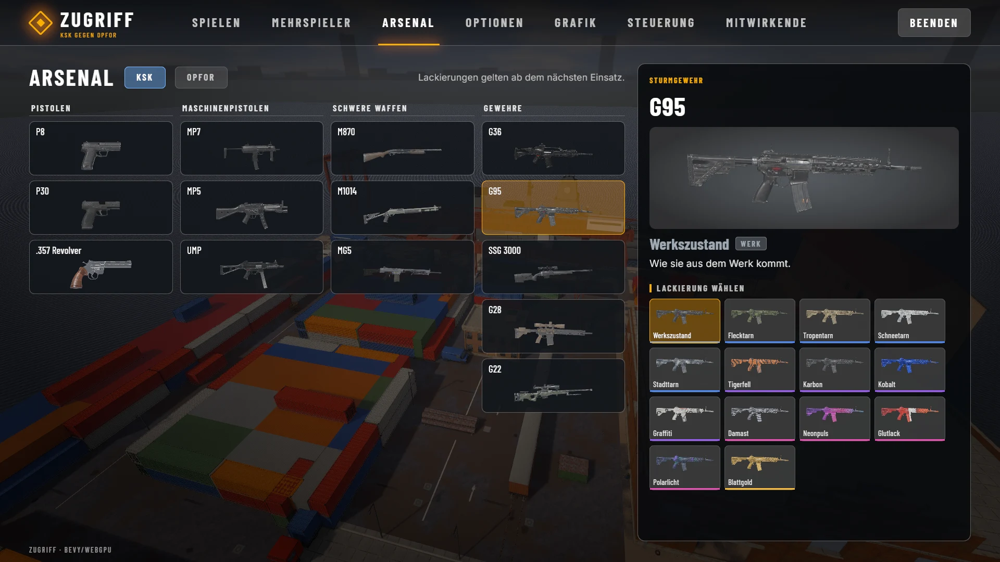
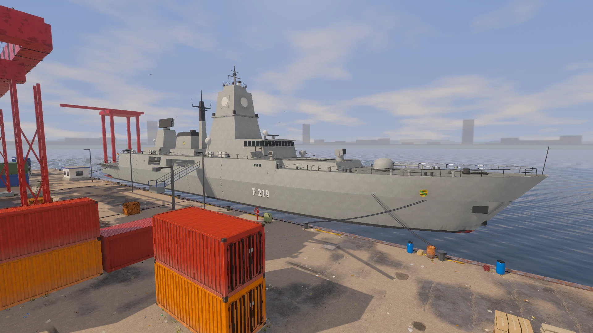
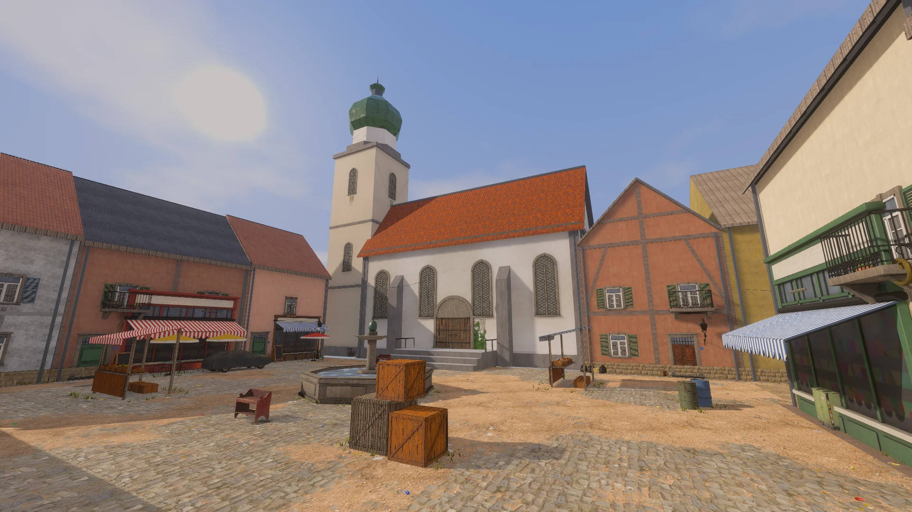
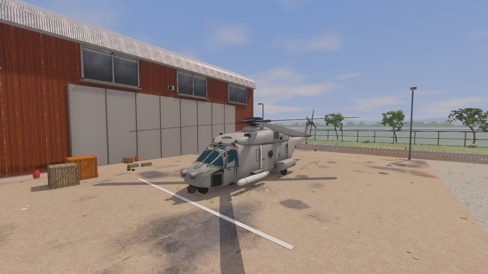

# ZUGRIFF

A standalone tactical shooter built with Rust and Bevy. Play 5v5 with bots, host a multiplayer room,
or join a dedicated server. Bomb defusal, hostage rescue and deathmatch across Hafen, Altstadt and
Fliegerhorst. Early development; the in-game interface is German.

[Download the latest release](https://github.com/birkmann/zugriff/releases/latest) · [Website](https://birkmann.github.io/zugriff/) · [Game guide](docs/GAME.md)

[](website/assets/menu.webp)

Choose your map, side and match settings, then deploy. Captured in the game at 1920 × 1080.

## Play

Download a package from Releases and extract it completely. Keep `assets/` beside the executable.

- **Linux x86_64:** make the `.AppImage` executable and run it, or extract the `.tar.gz` and run `./zugriff`. A recent Vulkan-capable graphics driver,
  ALSA, udev, Wayland/X11 and xkbcommon runtime libraries are required. CI builds on Ubuntu 22.04.
- **Windows x86_64:** extract the ZIP and open `zugriff.exe`.
- **macOS Apple silicon:** open the DMG, copy `ZUGRIFF.app` to Applications, then open it. Builds are
  ad-hoc signed, not notarized; macOS may require approval in Privacy & Security.

No Rust installation is required for a downloaded build. Offline bot matches need no server.
WASD moves, mouse aims, left click fires, R reloads, B opens the buy menu, E interacts, Tab shows the
scoreboard, Escape opens the menu. The Controls screen lists all bindings.

## Screenshots

Real in-game captures. Select an image to view it at full resolution.

| In action — Altstadt | Arsenal — weapons and finishes |
| --- | --- |
| [](website/assets/altstadt-action.webp) | [](website/assets/arsenal.webp) |

| Hafen | Altstadt | Fliegerhorst |
| --- | --- | --- |
| [](website/assets/hafen.webp) | [](website/assets/altstadt.webp) | [](website/assets/fliegerhorst.webp) |
| Warehouses, cargo and contested sightlines. | Town squares, narrow streets and market stalls. | Hangars, open ground and the air-base apron. |

## Develop

Install stable Rust. Linux build dependencies (Debian/Ubuntu):

```sh
sudo apt-get install build-essential pkg-config libasound2-dev libudev-dev libwayland-dev libxkbcommon-dev libx11-dev libxi-dev libxrandr-dev
cargo run --locked --profile native -p zugriff
cargo test --locked -p zugriff_sim -p zugriff_server
python3 packaging/package.py
python3 packaging/appimage.py  # Linux: also make a single-file AppImage
```

The packager creates an archive in `dist/`, bundles all game assets and the dedicated server, and
writes SHA-256 checksums. `--skip-build` packages an existing native build. A custom Cargo target
folder is detected automatically. `--target-dir PATH` overrides it.

Assets are located beside the executable (or in a macOS app's Resources directory), with the source
checkout as a development fallback. Override using `--assets PATH` or `ZUGRIFF_ASSETS`.
Settings use the platform's user configuration folder.

## Multiplayer

```sh
# From a downloaded bundle:
./zugriff-server --name "My server" --room zg_hafen,zg_altstadt:Public
./zugriff --server ws://127.0.0.1:27015/zg
# From source:
cargo run --locked --profile native -p zugriff_server -- --name "My server"
```

The server listens on TCP 27015. Add its address in the multiplayer menu. `/health` and `/rooms`
provide HTTP status and room listings. On macOS the server binary is inside
`ZUGRIFF.app/Contents/MacOS/`. See [the game guide](docs/GAME.md) for room commands and rules.

## Website and releases

`website/` is a static site with local fonts and real game screenshots. Preview with
`python3 -m http.server 8080 --directory website`. GitHub Pages uses the `Website` workflow; set
**Settings → Pages → Source → GitHub Actions** once. All site paths work under `/zugriff/`.
The repository and downloads are public. Platform buttons discover the latest published release
assets from GitHub; unavailable platforms keep a link to Releases. No credentials are needed.
The website is deployed by GitHub Actions to https://birkmann.github.io/zugriff/.

Push a `v*` tag (for example `v0.1.0`) to build Linux, Windows and Apple silicon macOS packages and
publish the successful packages to a GitHub release. A failed platform does not block the other downloads; rerunning its failed job adds the missing package. Running `Release` manually produces workflow
artifacts without publishing. The `Checks` workflow tests the simulation, server and site.

The optional browser client remains available: install the `wasm32-unknown-unknown` Rust target,
Trunk and wasm-opt, then run `./build-web.sh` (use `PUBLIC_URL` for a subpath). Output and assets go
into `prebuilt/`; the marketing site does not ship this large optional build.

## Repository

`game/` — Bevy client · `server/` — dedicated server · `crates/zugriff_sim/` — game rules and bots ·
`assets/` — runtime content · `tools/` — asset pipelines · `packaging/` — desktop distribution ·
`website/` — marketing and downloads.

Vehicle re-authoring optionally needs the original Nexus model sources via
`ZUGRIFF_VEHICLE_SOURCES`; playing and packaging use the committed GLBs and need no other repository.

Extracted from `eu-ui/zugriff` at `a4a06a1`. [Attribution and licensing](THIRD_PARTY.md).
